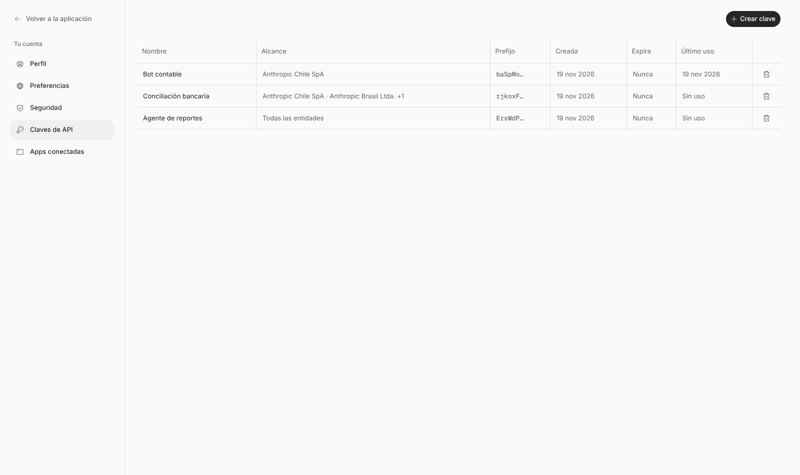
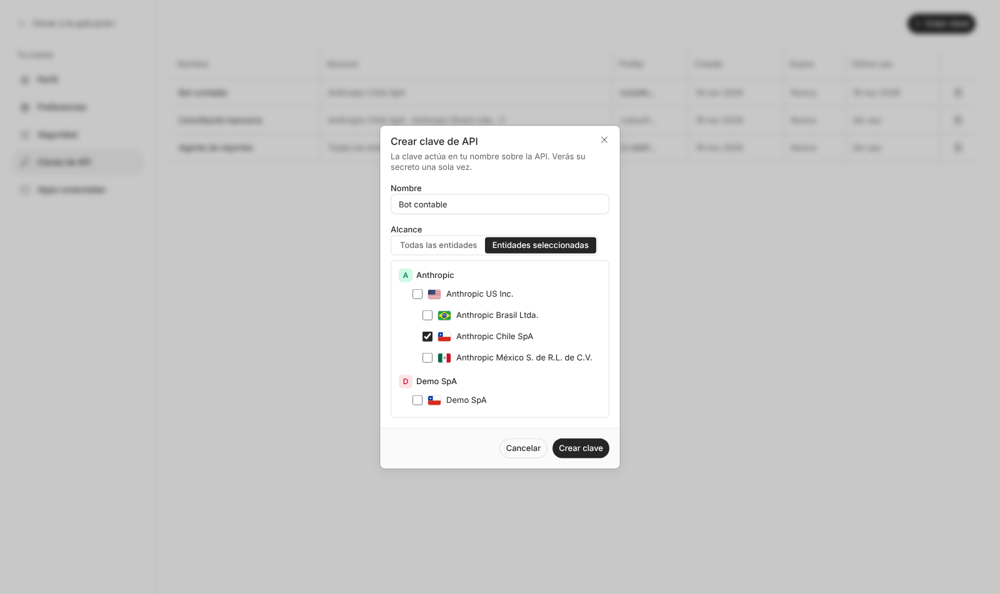
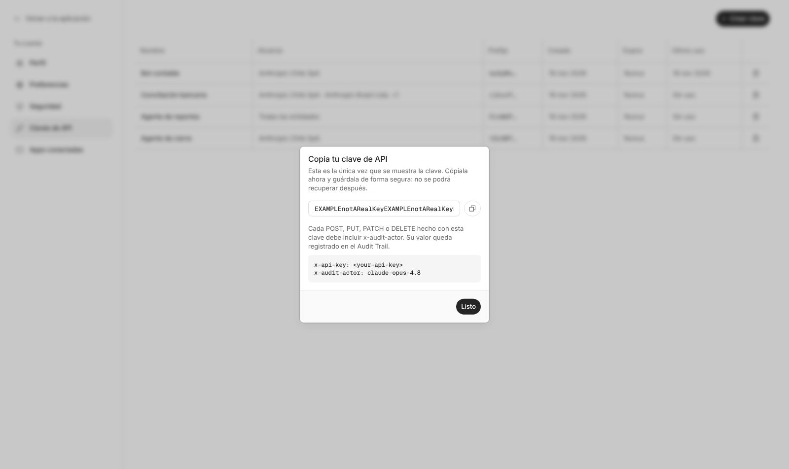

Las claves de API de Sintropix permiten que agentes e integraciones se autentiquen como un Usuario sin una sesión de navegador. Cada clave es una credencial de larga duración que se envía en el encabezado `x-api-key`, actúa como el Usuario propietario con sus Membresías de Organización, alcanza las Entidades que permite su [alcance](#alcance-de-la-clave) y está limitada a 25.000 solicitudes por hora.

Las claves se crean en la aplicación web de Sintropix en [app.sintropix.com](https://app.sintropix.com). Todo el proceso toma menos de un minuto.

<Steps>
  <Step title="Inicia sesión y abre Tu cuenta">
    Inicia sesión como el Usuario en cuyo nombre actuará la clave. La clave actúa con las Membresías de Organización de ese Usuario y sus Roles, así que elige un Usuario con el acceso que la integración realmente necesita.

    El inicio de sesión siempre pide la **Verificación en dos pasos**. Por defecto, Sintropix te envía un código de 6 dígitos por correo después de la contraseña. El código vence a los 5 minutos. Haz clic en **Enviar otro código** para recibir uno nuevo; solo sirve el último. Después de 5 códigos incorrectos, debes ingresar tu contraseña de nuevo.

    Tu primer inicio de sesión empieza en el enlace para definir tu contraseña que Sintropix te envía por correo. Elige una contraseña de entre 8 y 128 caracteres y haz clic en **Guardar contraseña**. Sintropix inicia tu sesión y te envía un código por correo para activar la verificación en dos pasos, así que escribes tu contraseña una sola vez. Si inicias sesión desde la página de inicio de sesión antes de activar la verificación en dos pasos, Sintropix te envía el código justo después de la contraseña. Si el enlace ya se usó o venció, la página muestra **Enlace no válido**. Haz clic en **Pedir un enlace nuevo** para solicitar otro.

    Si olvidaste tu contraseña, haz clic en **¿Olvidaste tu contraseña?** en la página de inicio de sesión e ingresa tu correo. Si la dirección tiene una cuenta en Sintropix, recibes un enlace para elegir una contraseña nueva. El enlace vence en 1 hora y sirve una sola vez. Al guardar la contraseña nueva se cierran todas tus sesiones; luego Sintropix inicia tu sesión en la misma página y te pide el segundo factor.

    Si prefieres una aplicación de autenticación, elige **Usar una aplicación de autenticación** durante la configuración. Para entonces, Sintropix ya te envió un código por correo, que puedes ignorar. También puedes cambiar más tarde: haz clic en **Configurar aplicación de autenticación** en **Tu cuenta** > **Seguridad**. Escaneas un código QR, confirmas un código y guardas 10 códigos de respaldo. Desde entonces, el inicio de sesión pide el código de la aplicación o un código de respaldo, y Sintropix deja de enviarte códigos por correo. Solo una sesión con verificación en dos pasos puede crear claves de API.

    Haz clic en tu nombre, en la parte inferior de la barra lateral izquierda, y elige **Tu cuenta**.
  </Step>
  <Step title="Ve a Claves de API">
    **Tu cuenta** se abre en **Perfil**. En la lista de la izquierda, haz clic en **Claves de API**. La página está en `https://app.sintropix.com/account/api-keys`.

    La página lista todas las claves que te pertenecen con su nombre, su alcance en la columna **Alcance**, prefijo, fecha de creación, vencimiento y último uso. Puedes revocar una clave desde el ícono de papelera de cada fila.

    <Frame caption="Claves existentes. Solo se muestra el prefijo; el secreto no vuelve a mostrarse después de la creación.">
      
    </Frame>
  </Step>
  <Step title="Crea la clave">
    Haz clic en **Crear clave**, arriba a la derecha de la página. Dale a la clave un nombre descriptivo (por ejemplo `erwin-agent` o `reconciliation-bot`) para poder identificarla después en la lista de claves y en el registro de auditoría.

    En **Alcance**, elige las Entidades que alcanza la clave:

    - **Todas las entidades** (la opción por defecto) alcanza todas las Entidades a las que tienes acceso, en todas tus Organizaciones. También alcanza las Entidades que se agreguen después.
    - **Entidades seleccionadas** alcanza solo las Entidades que marques. La lista agrupa tus Entidades por Organización, y puedes marcar Entidades de más de una Organización. Marca al menos una: **Crear clave** sigue desactivado hasta que lo hagas.

    Elige **Entidades seleccionadas** cuando la integración solo necesita algunas empresas (por ejemplo, un bot contable que atiende a un solo cliente), para que una clave filtrada no pueda tocar el resto. No puedes cambiar el alcance después. Para alcanzar otras Entidades, crea una clave nueva y revoca la anterior. Consulta [Alcance de la clave](#alcance-de-la-clave) para ver qué puede y qué no puede hacer una clave de Entidades seleccionadas.

    Haz clic en **Crear clave** en el diálogo para generar la clave.

    <Frame caption="Nombra la clave según el software que la va a usar y elige su alcance en Alcance.">
      
    </Frame>
  </Step>
  <Step title="Copia el secreto">
    La clave se muestra una sola vez. Cópiala con el botón junto al campo y guárdala en tu gestor de secretos antes de hacer clic en **Listo**. Sintropix no vuelve a mostrar el secreto después de esta pantalla; si lo pierdes, revoca la clave y crea una nueva.

    El diálogo también muestra los encabezados `x-api-key` y `x-audit-actor`. Toda solicitud que modifica datos necesita además `x-audit-reason`, que el diálogo no lista. Consulta [Autenticación](/es/api-reference/overview#autenticación) para ver todos los encabezados de auditoría.

    <Frame caption="El diálogo del secreto de un solo uso muestra los encabezados x-api-key y x-audit-actor. Las solicitudes que modifican datos necesitan además x-audit-reason.">
      
    </Frame>
  </Step>
  <Step title="Llama a la API">
    Envía la clave en el encabezado `x-api-key` en cada solicitud:

    ```bash
    curl https://api.sintropix.com/api/entities \
      -H "x-api-key: $SINTROPIX_API_KEY"
    ```

    Toda solicitud que modifica datos (`POST`, `PUT`, `PATCH`, `DELETE`) hecha con una clave debe enviar además dos encabezados:

    - `x-audit-actor` nombra al software que actúa (por ejemplo `my-agent`).
    - `x-audit-reason` explica por qué se realiza el cambio, en una sola línea de texto plano de hasta 500 caracteres.

    [`POST /api/feedback`](/es/api-reference/feedback) es la única excepción: no necesita ninguno de los dos encabezados, y también puede enviarla una clave de solo lectura.

    Ambos valores se registran tal cual en el sobre del [registro de auditoría](/api-reference/audit-trail). Omitir `x-audit-actor` devuelve `400` con el código `AUDIT_ACTOR_REQUIRED_ERROR`. Un `x-audit-reason` ausente o vacío devuelve `400` con el código `AUDIT_REASON_REQUIRED_ERROR`; un valor de más de 500 caracteres devuelve `400` con el código `AUDIT_REASON_TOO_LONG_ERROR`.

    ```bash
    curl -X POST https://api.sintropix.com/api/entities/$ENTITY_ID/partners \
      -H "x-api-key: $SINTROPIX_API_KEY" \
      -H "x-audit-actor: my-agent" \
      -H "x-audit-reason: Crear Servicios Cloud SpA desde el correo de onboarding de julio" \
      -H "Content-Type: application/json" \
      -d '{
        "id": "0b6c0f2e-5a4d-4e8f-b1c3-7d9e2a4f6c88",
        "name": "Servicios Cloud SpA",
        "country": "CL",
        "taxId": "76123456-0"
      }'
    ```

    Las solicitudes a `/api/auth/*` se rechazan cuando llevan `x-api-key`, y `POST /api/api-keys` rechaza una clave con `403`, así que una clave no puede usarse para crear más claves ni para administrar Usuarios.

    Las solicitudes hechas con una clave de API no piden un código de verificación en dos pasos. El segundo factor se comprueba una sola vez, al crear la clave.
  </Step>
</Steps>

## Alcance y permisos

- Una clave se autentica como su Usuario propietario, con las Membresías de Organización de ese Usuario. Consulta [Acceso y roles](/es/api-reference/overview#acceso-y-roles).
- Una clave nunca hace trabajo de Superadmin, aunque sea de un Superadmin. Administrar Usuarios, Organizaciones y Membresías requiere una sesión iniciada; una clave recibe `403` con `SUPERADMIN_SESSION_REQUIRED`.
- Las rutas de negocio están acotadas por Entidad (`/api/entities/{entityId}/...`). Una clave solo puede acceder a las Entidades de las Organizaciones en las que el Usuario propietario tiene una Membresía, y solo puede hacer lo que el Rol del Usuario allí permite. Una clave de un `viewer` solo puede leer.
- Una clave alcanza solo las Entidades que permite su [alcance](#alcance-de-la-clave), y nunca más de lo que alcanza el Usuario propietario.

## Alcance de la clave

Cada clave declara su alcance al crearse, y el alcance nunca cambia. Las Membresías y los Roles del Usuario propietario limitan ambos tipos, así que un alcance solo restringe lo que la clave puede hacer.

| Alcance | En la aplicación | Alcanza |
| --- | --- | --- |
| `all_entities` | **Todas las entidades** | Todas las Entidades a las que llega el Usuario propietario, en todas sus Organizaciones, incluidas las Entidades que se agreguen después de crear la clave. |
| `listed_entities` | **Entidades seleccionadas** | Solo las Entidades que lista la clave: al menos una, de cualquiera de las Organizaciones del Usuario propietario. |

Una clave de Entidades seleccionadas trabaja con los libros de sus Entidades y con las Organizaciones a las que pertenecen, pero nunca actúa sobre una Organización completa, aunque liste todas sus Entidades:

- Las solicitudes a `/api/entities/{otherEntityId}/...` de una Entidad que no lista devuelven `404`. `GET /api/entities` lista solo sus Entidades y `GET /api/organizations` devuelve un arreglo vacío.
- Alcanza los [Partners](/api-reference/partners#organization-partners) y las [Dimensiones](/api-reference/dimensions#dimensions-belong-to-the-organization) de las Organizaciones de sus Entidades. Solo puede fusionar un Partner que ninguna Entidad no listada usa.
- Lista todas las [Integraciones](/api-reference/integrations#integrations-belong-to-the-organization) de esas Organizaciones, nunca un secreto, pero no puede conectar, renovar ni desconectar ninguna, ni leer su contenido, como el correo o los archivos (`403` con `PERMISSION_DENIED_ERROR`). Solo agrega o quita los feeds que llegan a sus propias Entidades.
- Las rutas que administran una Organización completa, como [Agent Channels](/api-reference/agent-channels), los [vínculos intercompañía](/es/api-reference/intercompany-links#acceso) y los [informes consolidados](/api-reference/consolidation#access) (también al leer) y [`GET /api/organizations/{organizationId}/role`](/api-reference/organizations#get-/organizations/organizationid/role), devuelven `403`.
- Cualquier otra Organización responde `404`.

Ninguna clave de API puede crear Entidades. Una Entidad que lista una clave no se puede eliminar mientras la clave exista.

Las claves creadas antes de que existieran los alcances conservan lo que alcanzaban: una clave acotada a una Entidad ahora lista esa Entidad, y todas las demás alcanzan todas las Entidades.

## Administra las claves por la API

La página **Claves de API** usa estas rutas. Requieren una sesión iniciada en el navegador que pasó la verificación en dos pasos. Una solicitud con una clave de API o un token de acceso OAuth recibe `403` con `PERMISSION_DENIED_ERROR`.

### Crear una clave

`POST /api/api-keys` crea una clave para el Usuario que inició sesión y devuelve su secreto una sola vez.

| Campo | Tipo | Reglas |
| --- | --- | --- |
| `name` | string | Obligatorio. De 1 a 32 caracteres, sin contar los espacios de los extremos. |
| `expiresIn` | entero o `null` | Obligatorio. Segundos hasta que la clave vence, de `3600` (1 hora) a `31536000` (1 año). `null` crea una clave que no vence. |
| `scope` | objeto | Obligatorio. `{ "kind": "all_entities" }`, o `{ "kind": "listed_entities", "entityIds": [...] }` con al menos un id de Entidad, cada uno una sola vez. |

```json
{
  "name": "reconciliation-bot",
  "expiresIn": null,
  "scope": {
    "kind": "listed_entities",
    "entityIds": [
      "5f1c2a9e-8d4b-4c7a-9e21-3b6f0d8a4c12",
      "a2e7d3c1-6b9f-4e05-8c4a-1d7e9f2b3a60"
    ]
  }
}
```

La respuesta es el objeto de la clave, con su secreto en `key`:

| Campo | Tipo | Descripción |
| --- | --- | --- |
| `id` | string | El id de la clave. |
| `name` | string | El nombre de la clave. |
| `start` | string o `null` | Los primeros caracteres del secreto, que se muestran en la lista de claves. |
| `prefix` | string o `null` | El prefijo de la clave. |
| `createdAt` | string | Marca de tiempo ISO 8601. |
| `expiresAt` | string o `null` | Marca de tiempo ISO 8601, o `null` si la clave no vence. |
| `lastRequest` | string o `null` | Marca de tiempo ISO 8601 de la última solicitud de la clave. |
| `scope` | objeto | El alcance de la clave, tal como se envió. |
| `key` | string | El secreto. Solo esta respuesta lo devuelve. |

| Estado | Código | Cuándo |
| --- | --- | --- |
| `400` | — | Falta un campo o no cumple sus reglas: `entityIds` vacío o con duplicados, un nombre de más de 32 caracteres o un `expiresIn` fuera de rango. |
| `403` | `PERMISSION_DENIED_ERROR` | La solicitud lleva una clave de API o un token de acceso OAuth. |
| `404` | `ENTITY_NOT_FOUND_ERROR` | Una Entidad listada no existe o el Usuario que inició sesión no llega a ella. |

La ruta anterior `POST /api/auth/api-key/create` ya no crea claves. Devuelve `403` con `API_KEY_SCOPE_REQUIRED`.

### Listar tus claves

`GET /api/api-keys` devuelve las claves del Usuario que inició sesión, cada una con los campos anteriores salvo `key`. No lista las claves que Erwin crea para sus propios turnos.

### Revocar una clave

Revoca una clave desde el ícono de papelera de su fila, o con `POST /api/auth/api-key/delete` y `{ "keyId": "..." }` desde una sesión iniciada.

## Límites de solicitudes

Cada clave está limitada a **25.000 solicitudes por hora** en una ventana deslizante. Las solicitudes que superan el límite devuelven `429 Too Many Requests`; espera y reintenta cuando la ventana se reinicie.

## Rotación y revocación

- Rota las claves de forma periódica y cada vez que un miembro del equipo con acceso deje la empresa.
- Revoca una clave de inmediato desde **Tu cuenta → Claves de API** si sospechas que se filtró. La revocación aplica desde la siguiente solicitud.
- Toda acción realizada con una clave queda registrada en el [registro de auditoría](/api-reference/audit-trail) bajo el Usuario propietario, así que la actividad de una clave filtrada es rastreable.

<Card title="Descripción general de la API" icon="code" href="/es/api-reference/overview" horizontal>
  URL base, formato de solicitudes y respuestas, estructura de errores y alcance por Entidad.
</Card>
