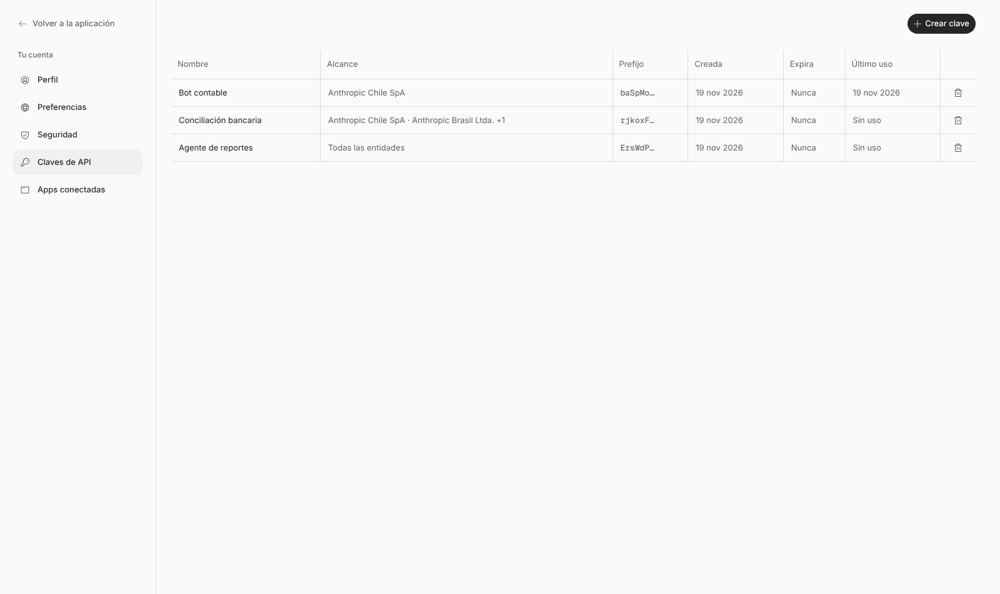
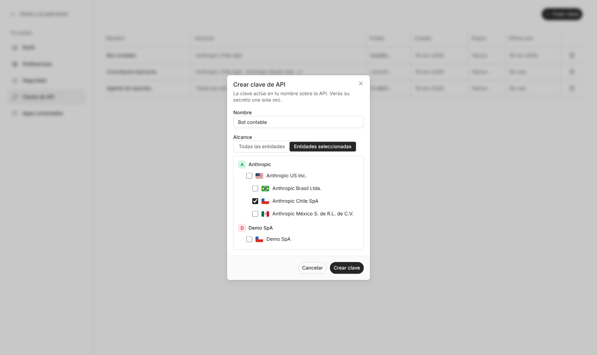
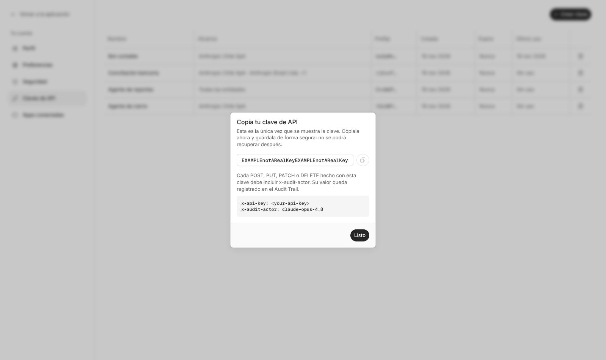

Sintropix API keys let agents and integrations authenticate as a User without a browser session. Each key is a long-lived credential passed in the `x-api-key` header, acts as the owning User with that User's Organization Memberships, reaches the Entities its [Key Scope](#key-scope) allows, and is rate-limited to 25,000 requests per hour.

Keys are created in the Sintropix web app at [app.sintropix.com](https://app.sintropix.com). The whole trip takes under a minute.

<Steps>
  <Step title="Sign in and open Tu cuenta">
    Sign in as the User the key should act on behalf of. The key acts with that User's Organization Memberships and their Roles, so choose a User with the access the integration actually needs.

    Sign-in always asks for two-step verification (**Verificación en dos pasos**). By default, Sintropix emails you a 6-digit code after the password. The code expires after 5 minutes. Click **Enviar otro código** for a new one; only the latest code works. After 5 wrong codes, you must enter your password again.

    Your first sign-in starts from the set-password link Sintropix emails you. Choose a password of 8 to 128 characters and click **Guardar contraseña**. Sintropix signs you in and emails you a code to activate two-step verification, so you type your password only once. If you sign in from the sign-in page before two-step verification is active, Sintropix emails you the code right after the password. If the link was already used or has expired, the page shows **Enlace no válido**. Click **Pedir un enlace nuevo** to ask for another one.

    If you forgot your password, click **¿Olvidaste tu contraseña?** on the sign-in page and enter your email. If the address has a Sintropix account, you receive a link to choose a new password. The link expires after 1 hour and works once. Saving the new password signs you out of every session, then signs you in on the same page and asks for your second factor.

    If you prefer an authenticator app, choose **Usar una aplicación de autenticación** during setup. By then, Sintropix has already emailed you a code, which you can ignore. You can also switch later: click **Configurar aplicación de autenticación** under **Tu cuenta** > **Seguridad**. You scan a QR code, confirm a code, and save 10 backup codes. From then on, sign-in asks for the code from the app or a backup code, and Sintropix stops emailing codes. Only a session with two-step verification can create API keys.

    Click your name at the bottom of the left sidebar and choose **Tu cuenta**.
  </Step>
  <Step title="Go to Claves de API">
    **Tu cuenta** opens on **Perfil**. In the list on the left, click **Claves de API**. The page is at `https://app.sintropix.com/account/api-keys`.

    The page lists every key you own with its name, its scope in the **Alcance** column, prefix, creation date, expiry, and last use. Keys can be revoked from the trash icon on each row.

    <Frame caption="Existing keys. Only the prefix is shown; the secret is never displayed again after creation.">
      
    </Frame>
  </Step>
  <Step title="Create the key">
    Click **Crear clave** at the top right of the page. Give the key a descriptive name (for example `erwin-agent` or `reconciliation-bot`) so you can identify it later in the key list and the audit trail.

    Under **Alcance**, choose the Entities the key reaches:

    - **Todas las entidades** (the default) reaches every Entity you reach, in every Organization you belong to. It also reaches the Entities added later.
    - **Entidades seleccionadas** reaches only the Entities you check. The list groups your Entities by Organization, and you can check Entities of more than one Organization. Check at least one: **Crear clave** stays disabled until you do.

    Choose **Entidades seleccionadas** when the integration only needs some companies (for example a bookkeeping bot that services one client), so a leaked key can't touch the rest. You can't change the scope later. To reach other Entities, create a new key and revoke the old one. See [Key scope](#key-scope) for what a key of selected Entities can and can't do.

    Click **Crear clave** in the dialog to mint the key.

    <Frame caption="Name the key after the software that will use it, and choose its scope under Alcance.">
      
    </Frame>
  </Step>
  <Step title="Copy the secret">
    The key is shown once. Copy it with the button next to the field and store it in your secrets manager before clicking **Listo**. Sintropix does not display the secret again after this screen; if you lose it, revoke the key and create a new one.

    The dialog also shows the `x-api-key` and `x-audit-actor` headers. Every mutating request needs `x-audit-reason` too, which the dialog doesn't list. See [Authentication](/api-reference/overview#authentication) for every audit header.

    <Frame caption="The one-time secret dialog shows the x-api-key and x-audit-actor headers. Mutating requests also need x-audit-reason.">
      
    </Frame>
  </Step>
  <Step title="Call the API">
    Send the key in the `x-api-key` header on every request:

    ```bash
    curl https://api.sintropix.com/api/entities \
      -H "x-api-key: $SINTROPIX_API_KEY"
    ```

    Every mutating request (`POST`, `PUT`, `PATCH`, `DELETE`) made with a key must send two extra headers:

    - `x-audit-actor` names the software that is acting (for example `my-agent`).
    - `x-audit-reason` states why the change is being made, as one line of plain text up to 500 characters.

    [`POST /api/feedback`](/api-reference/feedback) is the one exception: it needs neither header, and a read-only key can send it too.

    Both values are recorded verbatim on the [audit trail](/api-reference/audit-trail) envelope. Omitting `x-audit-actor` returns `400` with code `AUDIT_ACTOR_REQUIRED_ERROR`. A missing or blank `x-audit-reason` returns `400` with code `AUDIT_REASON_REQUIRED_ERROR`; a value longer than 500 characters returns `400` with code `AUDIT_REASON_TOO_LONG_ERROR`.

    ```bash
    curl -X POST https://api.sintropix.com/api/entities/$ENTITY_ID/partners \
      -H "x-api-key: $SINTROPIX_API_KEY" \
      -H "x-audit-actor: my-agent" \
      -H "x-audit-reason: Create Servicios Cloud SpA from the July onboarding email" \
      -H "Content-Type: application/json" \
      -d '{
        "id": "0b6c0f2e-5a4d-4e8f-b1c3-7d9e2a4f6c88",
        "name": "Servicios Cloud SpA",
        "country": "CL",
        "taxId": "76123456-0"
      }'
    ```

    Requests to `/api/auth/*` are rejected when they carry `x-api-key`, and `POST /api/api-keys` refuses a key with `403`, so keys can't be used to mint further keys or manage Users.

    Requests made with an API key do not ask for a two-step verification code. The second factor is checked once, when the key is created.
  </Step>
</Steps>

## Scope and Permissions

- A key authenticates as its owning User, with that User's Organization Memberships. See [Access and roles](/api-reference/overview#access-and-roles).
- A key never does Superadmin work, even when a Superadmin owns it. Managing Users, Organizations, and Memberships needs a signed-in session; a key gets `403` with `SUPERADMIN_SESSION_REQUIRED`.
- Business routes are scoped by Entity (`/api/entities/{entityId}/...`). A key can only access Entities of the Organizations the owning User holds a Membership in, and only do what the User's Role there allows. A key owned by a `viewer` can only read.
- A key reaches only the Entities its [Key Scope](#key-scope) allows, and never more than the owning User reaches.

## Key scope

Every key states its Key Scope when it is created, and the scope never changes. The owning User's Memberships and Roles cap both kinds, so a scope only narrows what the key can do.

| Scope | In the app | Reaches |
| --- | --- | --- |
| `all_entities` | **Todas las entidades** | Every Entity the owning User reaches, in every Organization, including Entities added after the key was created. |
| `listed_entities` | **Entidades seleccionadas** | Only the Entities the key lists: at least one, from any of the owning User's Organizations. |

A key of listed Entities works with the books of its Entities and with the Organizations they belong to, but it never acts on a whole Organization, even when it lists every Entity:

- Requests to `/api/entities/{otherEntityId}/...` for an Entity it doesn't list return `404`. `GET /api/entities` lists only its Entities, and `GET /api/organizations` returns an empty array.
- It reaches the [Partners](/api-reference/partners#organization-partners) and [Dimensions](/api-reference/dimensions#dimensions-belong-to-the-organization) of its Entities' Organizations. It can only merge a Partner that no unlisted Entity uses.
- It lists every [Integration](/api-reference/integrations#integrations-belong-to-the-organization) of those Organizations, never a secret, but it can't connect, renew, or disconnect one, and it can't read Integration content such as email or files (`403` with `PERMISSION_DENIED_ERROR`). It adds or removes only the feeds that land in its own Entities.
- Routes that manage a whole Organization, such as [Agent Channels](/api-reference/agent-channels), [Intercompany Links](/api-reference/intercompany-links#access) and [consolidated reports](/api-reference/consolidation#access) (reads included), and [`GET /api/organizations/{organizationId}/role`](/api-reference/organizations#get-/organizations/organizationid/role), return `403`.
- Any other Organization answers `404`.

No API key can create Entities. An Entity that a key lists can't be deleted while the key exists.

Keys created before Key Scopes existed keep their reach: a key confined to one Entity now lists that Entity, and every other key reaches all Entities.

## Manage keys over the API

The **Claves de API** page uses these routes. They need a signed-in browser session that passed two-step verification. A request that carries an API key or an OAuth access token gets `403` with `PERMISSION_DENIED_ERROR`.

### Create a key

`POST /api/api-keys` creates a key for the signed-in User and returns its secret once.

| Field | Type | Rules |
| --- | --- | --- |
| `name` | string | Required. 1 to 32 characters after trimming. |
| `expiresIn` | integer or `null` | Required. Seconds until the key expires, from `3600` (1 hour) to `31536000` (1 year). `null` creates a key that never expires. |
| `scope` | object | Required. `{ "kind": "all_entities" }`, or `{ "kind": "listed_entities", "entityIds": [...] }` with at least one Entity id, each listed once. |

```json
{
  "name": "reconciliation-bot",
  "expiresIn": null,
  "scope": {
    "kind": "listed_entities",
    "entityIds": [
      "5f1c2a9e-8d4b-4c7a-9e21-3b6f0d8a4c12",
      "a2e7d3c1-6b9f-4e05-8c4a-1d7e9f2b3a60"
    ]
  }
}
```

The response is the key object with its secret in `key`:

| Field | Type | Description |
| --- | --- | --- |
| `id` | string | The key's id. |
| `name` | string | The key's name. |
| `start` | string or `null` | The first characters of the secret, shown in the key list. |
| `prefix` | string or `null` | The key's prefix. |
| `createdAt` | string | ISO 8601 timestamp. |
| `expiresAt` | string or `null` | ISO 8601 timestamp, or `null` for a key that never expires. |
| `lastRequest` | string or `null` | ISO 8601 timestamp of the key's last request. |
| `scope` | object | The Key Scope, as sent. |
| `key` | string | The secret. Only this response returns it. |

| Status | Code | When |
| --- | --- | --- |
| `400` | — | A field is missing or breaks its rules: an empty or duplicated `entityIds`, a name over 32 characters, or an `expiresIn` out of range. |
| `403` | `PERMISSION_DENIED_ERROR` | The request carries an API key or an OAuth access token. |
| `404` | `ENTITY_NOT_FOUND_ERROR` | A listed Entity doesn't exist or the signed-in User can't reach it. |

The older `POST /api/auth/api-key/create` route no longer creates keys. It returns `403` with `API_KEY_SCOPE_REQUIRED`.

### List your keys

`GET /api/api-keys` returns the signed-in User's keys, each with the fields above except `key`. The keys Erwin creates for its own turns aren't listed.

### Revoke a key

Revoke a key from the trash icon on its row, or with `POST /api/auth/api-key/delete` and `{ "keyId": "..." }` from a signed-in session.

## Rate Limits

Each key is limited to **25,000 requests per hour** on a sliding window. Requests over the limit return `429 Too Many Requests`; back off and retry after the window resets.

## Rotation and Revocation

- Rotate keys on a schedule and whenever a team member with access leaves.
- Revoke a key immediately from **Tu cuenta → Claves de API** if you suspect it has leaked. Revocation takes effect on the next request.
- Every action taken with a key is recorded in the [audit trail](/api-reference/audit-trail) under the owning User, so leaked-key activity is traceable.

<Card title="API Overview" icon="code" href="/api-reference/overview" horizontal>
  Base URL, request and response format, error envelope, and per-Entity scoping.
</Card>
